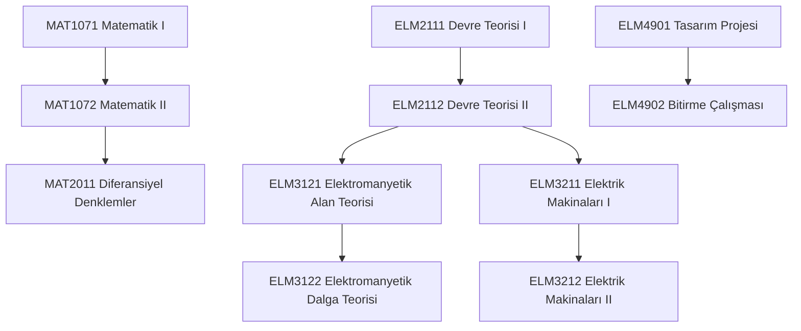

# Elektrik Mühendisliği Lisans Programı Önkoşul Zinciri

Elektrik Mühendisliği programında bir üst yarıyıldaki zorunlu dersi alabilmek için alt yarıyılda başarılması gereken dersler ve kritik önkoşul zinciri aşağıda listelenmiştir.

---

## 🔗 Önkoşul Tablosu

| Hedef Ders Kodu | Hedef Ders Adı | Gerekli Önkoşul Dersi | Yarıyıl |
| :--- | :--- | :--- | :--- |

---

## 📊 Kritik Önkoşul Akış Şeması (Mermaid)

