# EHM Bologna Önkoşul Zincirleri ve Bağımlılık Haritası

> [!IMPORTANT] Kritik Bilgi
> Önkoşullu bir dersi alabilmek için, o dersin önkoşulu olarak tanımlanan dersin/derslerin önceden alınmış ve **başarılmış (en az DD/DC ve üzeri)** olması zorunludur. Önkoşulu sağlanmayan ders OBS üzerinde seçilemez.

## 1. Resmi Önkoşul Listesi

| Ders Kodu | Ders Adı | Yarıyıl | Zorunlu Önkoşul Dersi | Açıklama |
|---|---|---|---|---|
| **EHM2171** | Elektrik Devre Temelleri Laboratuvarı | 3. Yarıyıl | **EHM1012** (Elektrik Devre Temelleri) | Devre temelleri teorisini geçmeyen laboratuvara giremez. |
| **EHM2162** | Lojik Devre Laboratuvarı | 4. Yarıyıl | **EHM2141** (Lojik Devreler) | Lojik devreler teorisi başarılmalıdır. |
| **EHM3151** | Elektronik Devreler 1 Laboratuvarı | 5. Yarıyıl | **EHM2122** (Elektronik Devreler 1) | Elektronik 1 teorisi başarılmalıdır. |
| **EHM3172** | Elektronik Devreler 2 Laboratuvarı | 6. Yarıyıl | **EHM3111** (Elektronik Devreler 2) | Elektronik 2 teorisi başarılmalıdır. |
| **EHM3152** | Haberleşme Laboratuvarı | 6. Yarıyıl | **EHM3131** (Haberleşme 1) | Haberleşme 1 teorisi başarılmalıdır. |
| **EHM3162** | Mikrodalga ve Anten Laboratuvarı | 6. Yarıyıl | **EHM3121** (Mikrodalga 1) | Mikrodalga 1 teorisi başarılmalıdır. |
| **EHM9000** | Bitirme Çalışması | 8. Yarıyıl | **EHM4200** (Tasarım Projesi) | Tasarım projesini başarmayan öğrenci Bitirme Tezine başlayamaz! |

## 2. Staj ve İlerleme Zincirleri
1. **Genel Staj (EHM2002):** En erken 4. yarıyılın sonunda yapılabilir.
2. **Mesleki Staj (EHM3002):** Önkoşul olarak Genel Stajın (EHM2002) yapılmış ve komisyonca kabul edilmiş olması şarttır.
3. **Tasarım Projesi (EHM4200):** En erken 7. yarıyılda alınabilir.

## 3. Görsel Önkoşul Akış Şeması

```mermaid
graph TD
    subgraph Devre_ve_Elektronik_Hatti
        EHM1012["EHM1012 Elektrik Devre Temelleri"] --> EHM2171["EHM2171 Elektrik Devre Temelleri Lab"]
        EHM1012 --> EHM2121["EHM2121 Devre ve Sistem Analizi"]
        EHM2121 --> EHM2122["EHM2122 Elektronik Devreler 1"]
        EHM2122 --> EHM3151["EHM3151 Elektronik Devreler 1 Lab"]
        EHM2122 --> EHM3111["EHM3111 Elektronik Devreler 2"]
        EHM3111 --> EHM3172["EHM3172 Elektronik Devreler 2 Lab"]
    end

    subgraph Lojik_ve_Islemci_Hatti
        EHM2141["EHM2141 Lojik Devreler"] --> EHM2162["EHM2162 Lojik Devre Lab"]
        EHM2141 --> EHM3141["EHM3141 Mikroişlemci Sistemleri"]
    end

    subgraph Haberlesme_ve_Mikrodalga_Hatti
        EHM2131["EHM2131 Elektromanyetik Alan"] --> EHM2132["EHM2132 Elektromanyetik Dalga"]
        EHM2132 --> EHM3121["EHM3121 Mikrodalga 1"]
        EHM3121 --> EHM3162["EHM3162 Mikrodalga ve Anten Lab"]
        EHM3121 --> EHM3112["EHM3112 Antenler ve Propagasyon"]
        EHM2152["EHM2152 İşaret ve Sistemler"] --> EHM3131["EHM3131 Haberleşme 1"]
        EHM3131 --> EHM3152["EHM3152 Haberleşme Lab"]
        EHM3131 --> EHM3122["EHM3122 Haberleşme 2"]
    end

    subgraph Bitirme_Hatti
        EHM4200["EHM4200 Tasarım Projesi (7. Yarıyıl)"] -->|Zorunlu Önkoşul| EHM9000["EHM9000 Bitirme Çalışması (8. Yarıyıl)"]
    end
```

