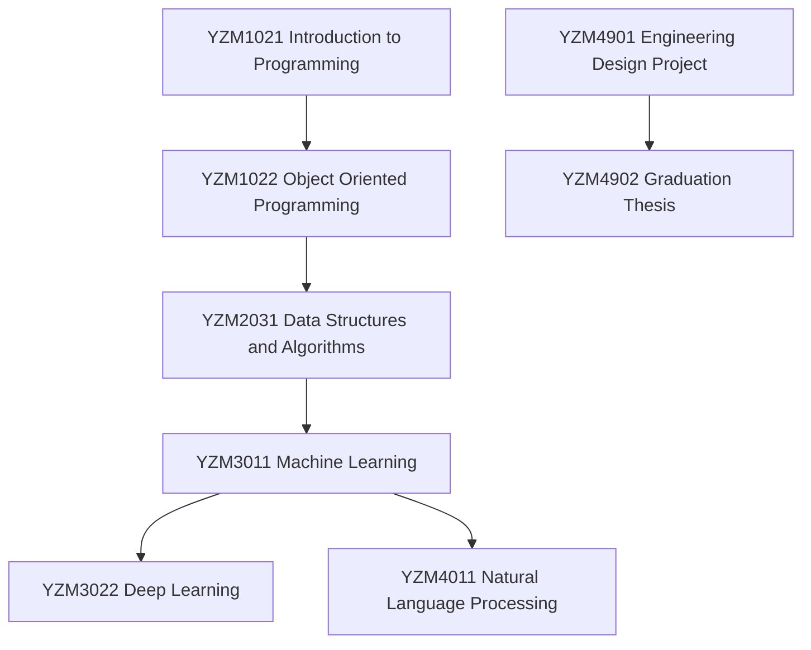

# Yapay Zeka ve Veri Mühendisliği Lisans Programı Önkoşul Zinciri

---

## 🔗 Önkoşul Tablosu

| Hedef Ders Kodu | Hedef Ders Adı | Gerekli Önkoşul Dersi | Yarıyıl |
| :--- | :--- | :--- | :--- |

---

## 📊 Kritik Önkoşul Akış Şeması (Mermaid)

